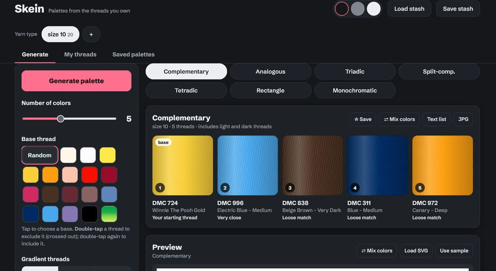

# Crafting-Toolbox

Small standalone crafting tools, including a tiling layout designer and a weaving pattern maker. Built with AI assistance.

## Current tools

### Skein
Create a list of your owned yarns and threads, then create palettes from them.

[**Download Skein**](downloads/Skein.zip)
Just download and run 

### Weaving Pattern Designer
Design your woven patterns.

[**Download Weaving Pattern Designer**](downloads/Weaving-Pattern-Designer.zip)
Just download and run

### Motif Tiler
Still in development. The basic functionality is in place.

[**Download Weaving Pattern Designer**](downloads/Motif-Tiler.zip)
Read the instructions - it is a bit more involved than the others.

### GIF to Counted Pattern
Converts a black-and-white image into a text-based counted pattern for crochet lace. Very basic; currently just a script.

[**Download GIF to Counted Pattern**](downloads/GIF-to-Counted-Pattern.zip.zip)
Read the instructions, minimum install required.